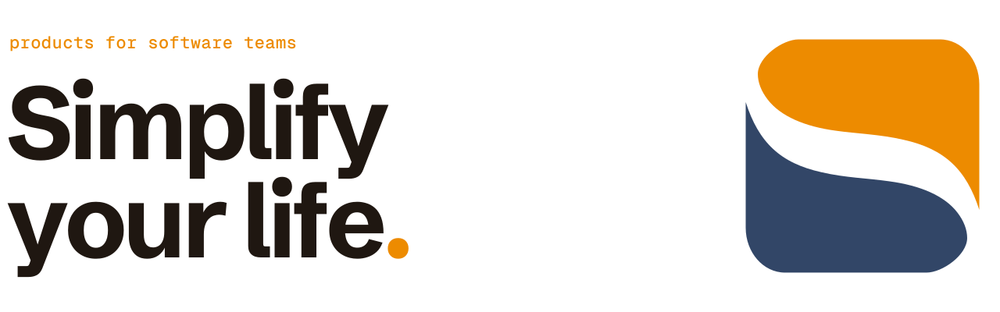

<a href="https://simyl.ai">
  <picture>
    <source media="(prefers-color-scheme: dark)" srcset="../assets/banner-dark.svg">
    
  </picture>
</a>

 

Simyl builds opinionated AI tools for software companies and the people who work at them. Each product does one thing exceptionally well. We are engineers who got tired of clunky tools, so we built the ones we wanted to use.

  
  
  
  

## Products

### [Simyl Flow](https://simyl.ai/products/flow) 

**The sprint lifecycle platform**

Flow connects planning poker, standups, demos, retros and coaching in one AI-powered platform. Health scores show whether your ceremonies are paying off.

- Data-driven retrospectives and real-time planning poker
- Daily standups drafted from commits, PRs and ticket changes
- Team health scores across 6 dimensions
- 8 integrations, including Jira, Linear, GitHub and GitLab

[Try Simyl Flow →](https://flow.simyl.ai) · [Learn more](https://simyl.ai/products/flow)

### [Simyl Code](https://simyl.ai/products/code) 

**AI coding, visualized**

Code is a VS Code extension that shows its work. Watch every file read, edit and command in real time, then automate whole feature implementations.

- Every action visible, with inputs, outputs and duration
- Workflows that run from research to plan to validated code
- Explicit approval for every sensitive operation
- Live token, cost and context tracking

[Learn more](https://simyl.ai/products/code)

### [Simyl Listen](https://simyl.ai/products/listen) 

**AI notes that think for you**

Capture voice or text and Listen does the rest. It also gives AI agents a way to ask a real person when they need an answer.

- Transcription, summaries, action items and smart tags
- Audio uploads up to 100 MB, straight from the browser
- Human-in-the-loop API: agents ask people by SMS
- Passwordless sign-in with an email code

[Try Simyl Listen →](https://listen.simyl.ai) · [Learn more](https://simyl.ai/products/listen)

### [Simyl CRM](https://simyl.ai/products/crm) 

**A CRM your agent can drive**

No forms to fill in. Your AI assistant reads and writes the record over the Model Context Protocol, and a person approves every change.

- 50 MCP tools, callable from Claude or any MCP client
- Every agent write waits in a human review queue
- Scoped OAuth clients, and no scope skips review
- Relationship networks that show who knows whom

[Try Simyl CRM →](https://crm.simyl.ai) · [Learn more](https://simyl.ai/products/crm)

## Free courses

Six courses on software delivery, hosted on Simyl Flow. They are free and need no signup.

| Course | What it covers | Time |
| :-- | :-- | :-- |
| [Software Delivery Fundamentals](https://flow.simyl.ai/learn/software-delivery-fundamentals) | Source control, tickets, estimation, and choosing your first process | 3–&#8288;4&nbsp;hours |
| [Scrum Master Essentials](https://flow.simyl.ai/learn/scrum-master) | Servant leadership and agile facilitation | 6–&#8288;8&nbsp;hours |
| [Kanban Essentials](https://flow.simyl.ai/learn/kanban) | Flow-based delivery for knowledge work | 4–&#8288;5&nbsp;hours |
| [XP Essentials](https://flow.simyl.ai/learn/xp) | Technical excellence and iterative delivery | 5–&#8288;6&nbsp;hours |
| [Lean Software Development Essentials](https://flow.simyl.ai/learn/lean) | Toyota's thinking, applied to software delivery | 5–&#8288;6&nbsp;hours |
| [SAFe Essentials](https://flow.simyl.ai/learn/safe) | Scaling agile across teams, programs and portfolios | 7–&#8288;9&nbsp;hours |

[Browse the free courses →](https://flow.simyl.ai/learn)

## How we build

We call it Engineered Simplicity: complex tools that feel effortless.

- **Opinionated design.** We make decisions so you don't have to.
- **Focused solutions.** Depth over breadth. Each tool does one thing exceptionally well.
- **Human potential.** Technology should amplify human judgment, not replace it.
- **Continuous evolution.** We keep improving our tools as the AI landscape changes.

[More about Simyl →](https://simyl.ai/about)

## Get in touch

- **Product news:** [subscribe at simyl.ai](https://simyl.ai/#subscribe)
- **General:** [hello@simyl.ai](mailto:hello@simyl.ai)
- **Enterprise:** [enterprise@simyl.ai](mailto:enterprise@simyl.ai)

---

Simyl · 18 King Street East, Toronto · <a href="https://simyl.ai/privacy">Privacy</a> · <a href="https://simyl.ai/terms">Terms</a>
